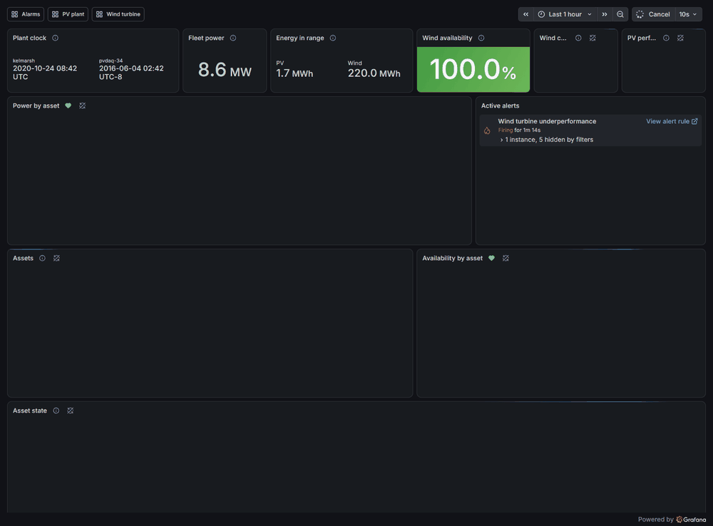
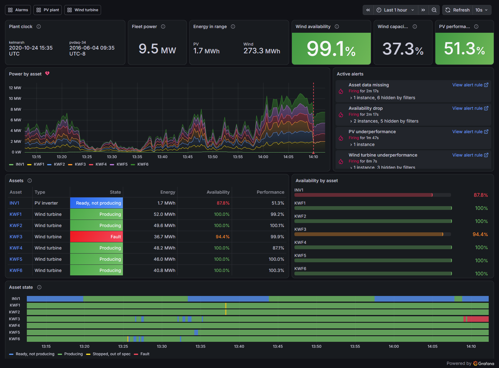
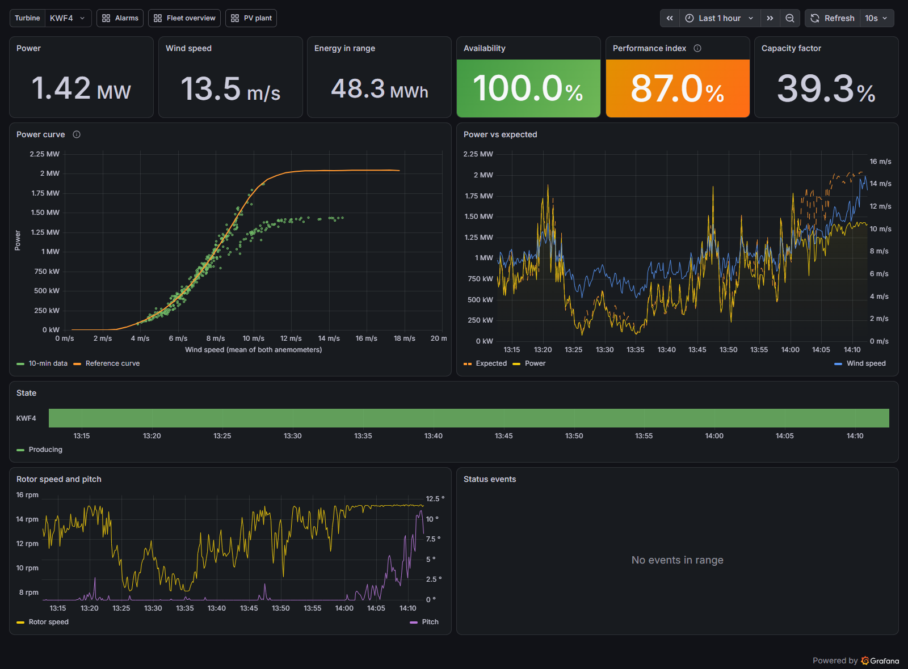
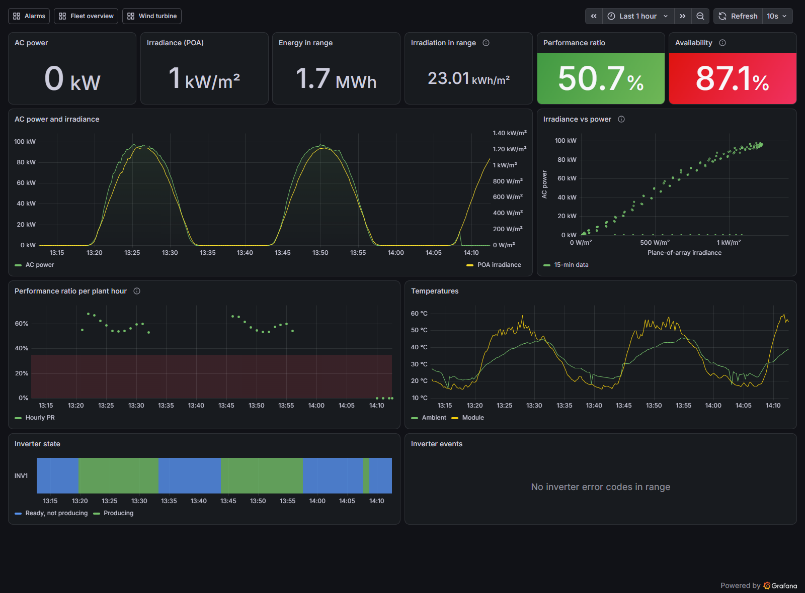
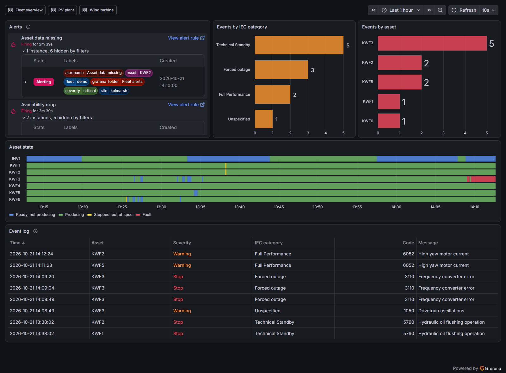

# Grafana fleet monitoring as code


Monitoring for a small renewable fleet - six 2 MW wind turbines and a 147 kWp PV roof - in **Grafana, configured
entirely from Python**: the InfluxDB datasource, four dashboards and four alert rules are generated by code,
committed as provisioning files and loaded by Grafana at start-up. Nothing is clicked together in the UI.

The data are real. Public SCADA from the Kelmarsh wind farm (UK) and NREL PVDAQ system 34 (Las Vegas) is
**replayed into InfluxDB 2 as a live stream on an accelerated clock** (60x by default), so the dashboards move
and the alerts fire on faults that actually happened: a 51-hour converter failure on one turbine and an inverter
that silently stopped producing ten days before it reported an error code.



*Fleet overview during the replay (one frame = 6 minutes of plant time): the PV inverter stops producing in full
sun, turbine KWF3 trips on a frequency converter error, and the alert list fills up.*

## What the replay shows

The default replay starts the wind farm at 24 Oct 2020 02:00 UTC and the PV roof at 3 Jun 2016 20:00 local time,
with 48 h of history, and the demo adds two faults on top. Alert times are in plant time after the event, from
the alert rules evaluated offline on the committed sample (`python -m fleet_as_code alert-timing` writes
`results/alert_timing.csv`); they match the state changes Grafana recorded in the run behind the screenshots
(its alert state history, exported to `results/grafana_state_history.csv`):

| Event | Real or injected | Alert | Fired after |
|---|---|---|---|
| KWF4 derated to 70 % for 12 h | injected | Wind turbine underperformance (KWF4) | 2.5 h |
| PV inverter stops producing at 06:00 local standard time on 4 Jun 2016 while reporting error code 0 | real | Availability drop (INV1) | 1.3 h |
| same | | PV underperformance (INV1) | 1.8 h |
| KWF2 stops sending data for 3.5 h | injected | Asset data missing (KWF2) | 0.3 h |
| KWF3 trips on a frequency converter error, 24 Oct 2020 12:09 UTC, down for 51 h | real | Availability drop (KWF3) | 2.7 h |

The PV case is the interesting one: the inverter stopped at 06:00 local standard time on 4 Jun 2016 while
reporting error code 0; the first error code (160) arrived on 14 Jun 07:28, about 10 days later, then 139; from
16 Jun 11:45 the inverter channels stop logging (data gap) and production resumes on 8 Jul, 34 days after the
stop (shared [PVDAQ site notes](https://github.com/kwwaleszczynski-del/pv-outage-classifier/blob/main/PVDAQ_SITE_NOTES.md)).
A PR rule on plane-of-array irradiance catches it 1.8 h after the stop, on the first day. No other alert fires in
this run (`results/alert_episodes.csv`).

## Quick start

```bash
cp .env.example .env              # then replace every change-me (random strings are fine)
python -m venv .venv && . .venv/bin/activate      # Windows: .venv\Scripts\activate
pip install -e ".[dev]"
docker compose up -d              # InfluxDB 2.9 + Grafana 13.2, ports bound to 127.0.0.1
python -m fleet_as_code replay --data tests/data --wind-start "2020-10-24 00:00" --pv-start "2016-06-04 06:00" --backfill-h 12
```

Open <http://localhost:3000> (dashboards are readable anonymously, the admin password is in `.env`). The
committed sample in `tests/data` holds two days of both sites (~110 kB). For the full month used in the
screenshots, download the source data (see [Data](#data-and-licenses)) and run:

```bash
python -m fleet_as_code prepare --kelmarsh-dir data/kelmarsh --pvdaq-dir data/pvdaq/system_34
python -m fleet_as_code replay --reset --fault derate:KWF4:3:12:0.7 --fault blackout:KWF2:11:3.5
python -m fleet_as_code verify    # runs every panel query through Grafana's API, lists alert states
```

**No Docker?** `python -m fleet_as_code portable fetch` downloads the official Grafana OSS and InfluxDB 2 binaries
(checked against the vendors' SHA-256), `portable up` runs both as a normal user on 127.0.0.1 with exactly the
same provisioning files. That is how the screenshots here were made, on a Windows machine without Docker.

## Dashboards

**Fleet overview** - plant clock of each site, fleet power, energy, wind availability and capacity factor, PV
performance ratio, stacked power per asset with alert annotations, firing alerts, an asset table (state, energy,
availability, performance; turbine names link to their detail dashboard) and the state of every asset over time.



**Wind turbine** (variable `turbine`) - the 10-minute power curve against the turbine's own reference curve,
power against expected power, performance index, rotor speed and pitch, state and the status log. Here KWF4 runs
with an injected 30 % derating: the scatter leaves the reference curve at about 1.4 MW instead of 2 MW.



**PV plant** - AC power against plane-of-array irradiance, the irradiance-power scatter, hourly PR with the
alert band, temperatures, inverter state and events. On the third day the inverter stops producing in full sun.



**Alarms** - alert instances, event counts by IEC category and by asset, the state timeline of the whole fleet
and the event log from the turbine status files and inverter error codes.



## Alert rules

Grafana-managed rules, one instance per asset (labels `site`, `asset`, `severity`), evaluated every 10 s.
Windows are defined in plant time and divided by the replay speed when the files are generated.

| Rule | Signal (Flux) | Fires when | Window | Pending |
|---|---|---|---|---|
| Wind turbine underperformance | sum(power) / sum(expected power) against the turbine's own reference curve, over fully available producing intervals expecting > 500 kW (at least 2 h of them) | < 85 % | 4 h | 30 min |
| PV underperformance | PR = E_AC / (P_STC x H_POA / 1000 W/m2), POA > 300 W/m2 | < 35 % | 2 h | 30 min |
| Asset data missing | plant minutes since the asset's last power record | > 30 min | 6 h | none; NoData alerts too |
| Availability drop | mean time-based availability (wind: IEC 61400-26-1 stop categories, PV: producing in daylight) | < 90 % | 24 h | none |

Each rule is a Flux query that returns one value per asset, a Reduce (last) and a Threshold expression. Rules carry
`__dashboardUid__` / `__panelId__` annotations, so their state shows up on the matching panels.

**Tuned on the unmodified data.** The rule logic was replayed in pandas over the whole month before settling the
thresholds (`python -m fleet_as_code calibrate` on the `prepare` output writes
`results/underperformance_calibration.json`). A first version of the underperformance rule, reconstructed as the
final rule with its changes undone (one fleet-wide reference curve, the 2019 turbine curves pooled; a 150 kW
floor; a 2 h window of which half, 1 h, must be producing intervals, of any availability), would have fired 81 times in the month on six healthy turbines, 71 of them at
4.5-6 m/s, where the steep part of the curve turns small wind speed differences into large relative errors, and
the largest share (22) on KWF1, which runs about 4 % below the fleet curve. Per-turbine reference curves, a
500 kW floor and a 4 h window (at least 2 h qualifying) bring that down to 5 episodes (about one per turbine per
month) while the injected 30 % derating is still caught about 2.5 h after it starts. A second lesson came from
KWF3: a restart attempt inside the converter outage (one interval at 112 kW against 1.9 MW expected) looked like
terrible performance, hence "fully available intervals only". The PV rule never fires on the ten days before the
inverter failure (lowest 2 h PR 0.48).

## How it works

```
Kelmarsh zips, PVDAQ CSVs --prepare--> data/replay/*.parquet --replay (60x clock)--> InfluxDB 2 (bucket fleet)
                             \--> reference/kelmarsh_power_curves.csv --setup--> InfluxDB 2 (bucket reference)
src/fleet_as_code/grafana/*.py --generate--> grafana/provisioning/*.yaml + grafana/dashboards/*.json --> Grafana
```

**Dashboards as code: plain JSON model, not grafanalib.** The dashboards are Python dicts in Grafana's own JSON
model, built by a few small functions (`panels.py`: stat, time series, XY chart, state timeline, table, bar
gauge, bar chart, alert list) and a grid helper that places panels left to right. grafanalib is community
maintained, trails new panel types and options (the XY chart's manual series mapping, alert list filters) and
does not cover the alert rule file format; the Grafana Foundation SDK is typed but pinned to a Grafana release and
a large dependency for four dashboards. With plain dicts every key Grafana stores is visible in code and in the
diff of the generated JSON, and the tests enforce what a typed SDK would: unique ids, a valid grid, the
provisioned datasource uid, queries that only touch existing measurements and fields, links that resolve. The
generated files are committed, so `docker compose up` works without Python, and CI fails if they drift from the
generator (`generate --check`).

**Provisioning.** Grafana loads `grafana/provisioning` at start-up: the InfluxDB datasource (Flux; token and URL
come from the environment and are never written to disk), a file provider for `grafana/dashboards` (read-only in
the UI) and the alert rule group. `fleet-as-code generate --speed 1` rewrites the rules for real-time data.

**Replay clock.** Wind and PV come from different years and continents, so each source gets its own historical
start that maps to "now". A record `dt` seconds of plant time after its start is written with the timestamp
`t0 + dt / speed` as soon as that moment has passed; 48 plant hours before the start are backfilled at once. A
heartbeat measurement carries the plant clock of each site for the overview. Faults can be injected on top of the
real data - `blackout` (an asset stops sending) and `derate` (power and energy scaled down) - so that every alert
rule can be demonstrated; they are kept apart from the historical events.

**InfluxDB schema** (bucket `fleet`, tags `site` and `asset` everywhere):

| Measurement | Fields |
|---|---|
| `wind_turbine` | power_kw, expected_kw, wind_speed, rotor_rpm, pitch_deg, ambient_temp_c, energy_kwh, available, state |
| `pv_inverter` | ac_kw, dc_kw, poa_wm2, module_temp_c, ambient_temp_c, energy_kwh, available, state, error_code |
| `event` (+ tags `severity`, `category`) | code, message |
| `replay` | source_time_ms, plant_clock, speed |
| `power_curve` (bucket `reference`, tags `asset`, `model`) | wind_speed, power_kw, samples |

**Data preparation.** For Kelmarsh the turbine status log (stop events with IEC 61400-26-1 categories) becomes a
per-interval state code and time-based availability: forced outages and scheduled maintenance count as
unavailable, environmental and grid stops as available. Wind speed is the mean of both nacelle anemometers (the
dataset's own "Wind speed" channel changes definition in April 2018). `expected_kw` comes from each turbine's own
reference power curve, built by the method of bins (IEC 61400-12-1 style, 0.5 m/s bins, normal operation only, no
air density correction) on its 2019 data, so the replayed month is not judged against itself. For PVDAQ
the power channels are hectowatts (checked against DC voltage x current), temperatures are converted from
degrees Fahrenheit with the site's 0 / -40 degF dropouts and single-step ambient glitches removed, and local
standard time (UTC-8) is converted to UTC.

## Things Grafana taught me on the way

`fleet-as-code verify` runs every panel query through Grafana's API and lists the alert states; together with the
screenshots it surfaced these:

- **A panel without `pluginVersion` is migrated as if it were old.** The XY chart then rewrites its options from
  the pre-11.1 format and drops the manual series mapping: "No data" with perfectly good frames. The generator
  stamps every panel with the pinned Grafana version (a test keeps it equal to the image tag).
- **The state timeline applied value mappings to text values only** (13.2): numeric state codes are converted
  with `string()` in Flux, and one mapping table then drives text, colour and legend.
- **Alert rule files reference folders by title.** When alerting was provisioned before the dashboards, Grafana
  created a second folder called "Fleet"; the rules now live in their own "Fleet alerts" folder.
- **Alert queries must return "wide" numeric frames.** A Flux aggregate keeps helper columns and loses `_time`,
  which the Reduce expression rejects; the shared queries end with a stamp-and-keep step.
- **A silent asset is not "no data".** It drops out of a `last()` query and its alert instance resolves as a
  missing series. The staleness rule looks six plant hours back, so the silent asset keeps a series and fires;
  the rule's NoData state (the whole replay stopped) alerts as well.
- The yearly Kelmarsh exports use different text encodings (2019 Latin-1, 2020 UTF-8), which breaks column names
  with a degree sign.

## Tests

`pytest -q` runs 98 tests in a few seconds, without network or Docker: the committed provisioning files match the
generator; dashboards have unique ids and titles, fit the 24-column grid without overlaps and only reference the
provisioned datasource, defined variables and existing dashboards; every Flux query (panels and rules) uses known
buckets, measurements and fields with balanced brackets; alert rules are well formed at 1x, 60x and 600x and link
to existing panels; no secret ends up in a provisioning file. Further tests cover the line protocol encoder, both
source parsers (encodings, units, time zones, dropouts), the status-to-state logic, the reference curve and the
replay on a fake clock. The offline alert evaluation must reproduce `results/` from the committed sample and
Grafana's recorded state changes of the demo run, and the numbers quoted in this README must equal `results/`.

The CI workflow runs the tests on Python 3.11 and 3.12, then a smoke job: `docker compose --profile render up`, a
600x replay of the committed sample, `verify` against the running Grafana (datasource health, provisioned
dashboards and rules, every panel query) and PNG renders of the four dashboards through the image renderer,
uploaded as a build artifact.

## Project layout

```
src/fleet_as_code/
  config.py            assets, InfluxDB schema, state codes, replay speed, pinned versions
  grafana/panels.py    JSON model builders and grid placement
  grafana/flux.py      Flux queries for panels and alert rules
  grafana/dashboards.py, alerts.py, provisioning.py    the four dashboards, the rule group, file rendering
  sources/kelmarsh.py  Greenbyte SCADA zips: 10-min data, status log -> state and availability
  sources/pvdaq.py     PVDAQ daily CSVs: units, time zone, dropouts, fault events
  reference.py         method-of-bins power curve and expected power
  prepare.py           raw downloads -> replay parquet files, test sample
  replay.py            accelerated clock, fault injection, line protocol batches
  influx.py            small InfluxDB 2 HTTP client (setup, buckets, write, delete, query)
  verify.py            checks a running stack through Grafana's API
  evaluate.py          alert rules evaluated offline in pandas: alert timing, rule calibration
  portable.py          Grafana + InfluxDB binaries without Docker
  cli.py               generate | prepare | setup | replay | verify | alert-timing | calibrate | portable
grafana/               generated provisioning files and dashboard JSON (committed)
reference/             per-turbine reference power curves (derived from Kelmarsh 2019)
results/               alert timing and calibration numbers quoted above, Grafana's state history of the demo run
scripts/capture.py     README screenshots and GIF (Playwright)
tests/                 pytest suite and a two-day data sample
```

## Limitations

- Alert windows are baked in for one replay speed (60x); run `generate --speed 1` for real-time data.
- The reference curves have no air density correction and come from one year of the same turbines; expected power
  is only as good as their 0.5 m/s bins, and about one underperformance alert per turbine-month remains on healthy data.
- The derating and the communication loss are injected; the converter failure and the inverter failure are real.
- Anonymous viewer access is enabled for the demo and the ports are bound to 127.0.0.1; switch both off before
  exposing the stack anywhere.
- The screenshots come from the portable binaries on Windows; the Docker Compose path is exercised by CI.

## Data and licenses

Code: MIT.

- Plumley, C. (2022). *Kelmarsh wind farm data*. Zenodo,
  [doi:10.5281/zenodo.16807551](https://doi.org/10.5281/zenodo.16807551), CC BY 4.0. `prepare` expects
  `Kelmarsh_SCADA_2019_3085.zip` (reference year, 311 MB) and `Kelmarsh_SCADA_2020_3086.zip` (474 MB) in
  `data/kelmarsh`.
- *Photovoltaic Data Acquisition (PVDAQ) Public Datasets*, Deline et al., NREL / Open Energy Data Initiative,
  [doi:10.25984/1846021](https://doi.org/10.25984/1846021), CC BY 4.0. System 34, daily files from the public
  bucket:

  ```bash
  python -c "import pandas as pd, pathlib, urllib.request as u; d = pathlib.Path('data/pvdaq/system_34'); d.mkdir(parents=True, exist_ok=True); [u.urlretrieve(f'https://oedi-data-lake.s3.amazonaws.com/pvdaq/csv/pvdata/system_id=34/year={t.year}/month={t.month}/day={t.day}/system_34__date_{t:%Y_%m_%d}.csv', d / f'system_34__date_{t:%Y_%m_%d}.csv') for t in pd.date_range('2016-05-25', '2016-06-24')]"
  ```

The raw data are not part of this repository. `tests/data` (a two-day slice of both sites) and
`reference/kelmarsh_power_curves.csv` are derived from these datasets under the same license.
